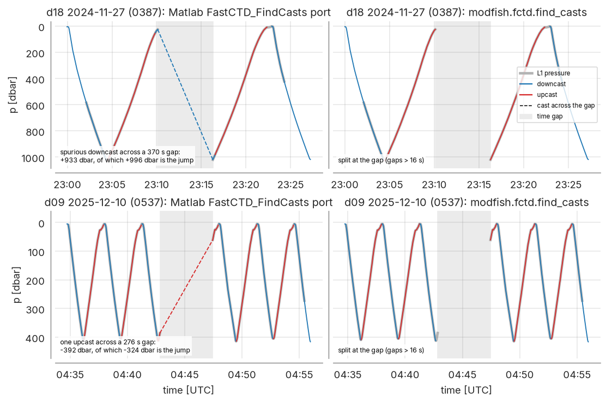
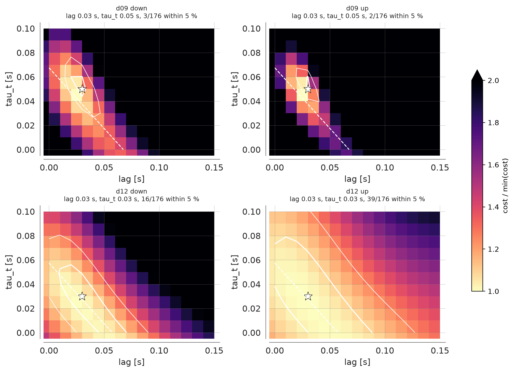
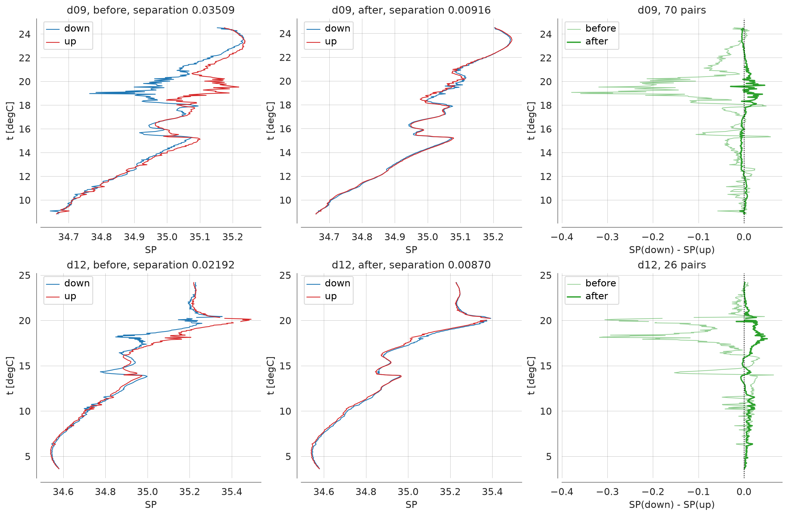
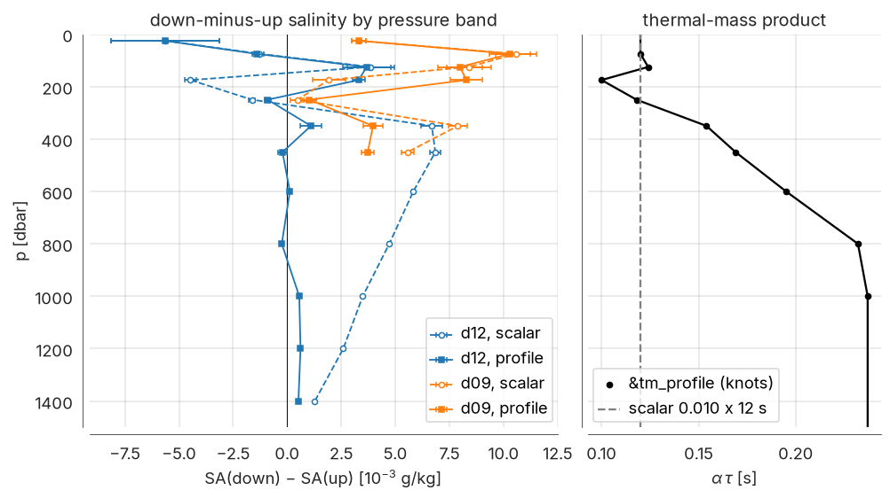
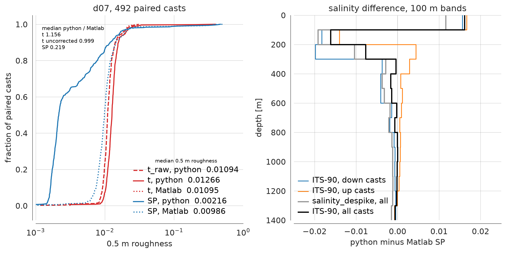
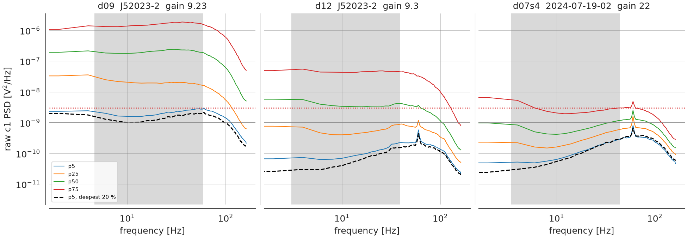
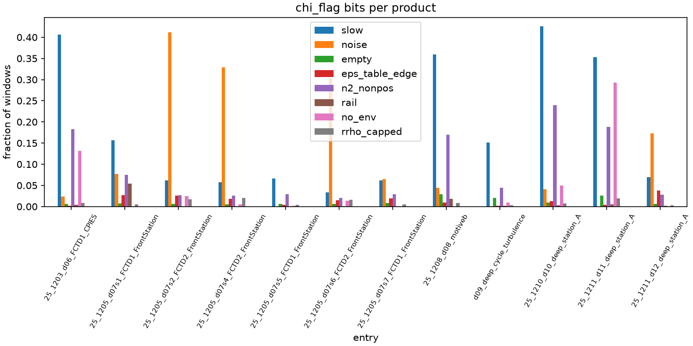
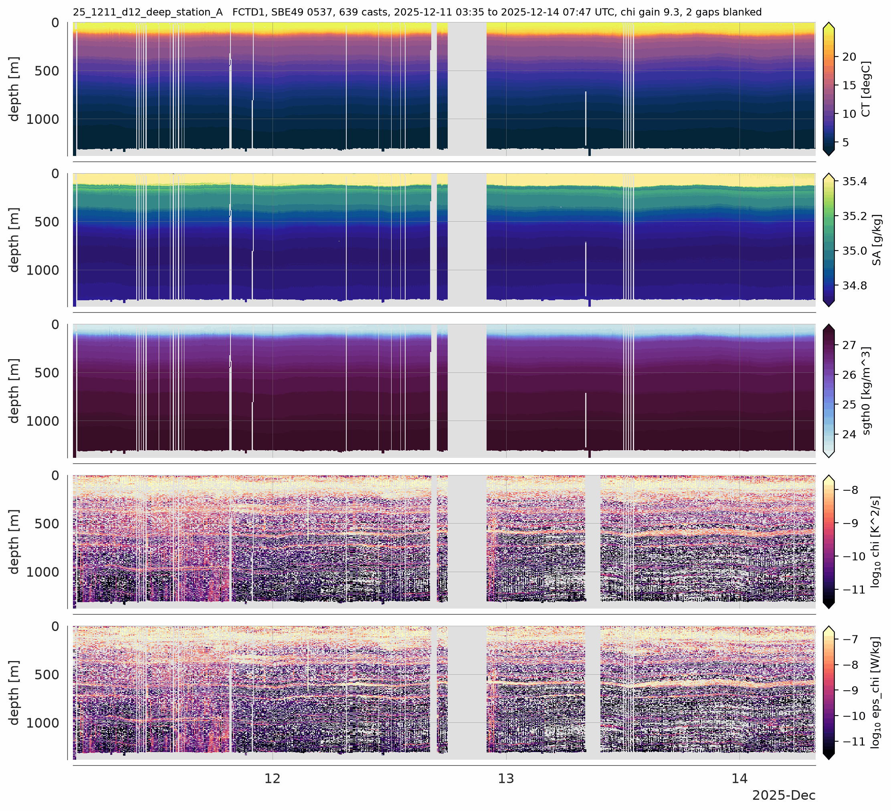

# FCTD processing in modfish, for users of the Matlab chain

Notes for people who process FCTD data with the Matlab chain in
`MOD_fish_lib/FastCTD_MATLAB` and want to run modfish on their own `.modraw` files or port
parts of it into their Matlab real-time and post-processing code.

- [fctd_processing.ipynb](fctd_processing.ipynb) runs one deployment from `.modraw` files to
  products, with the T-C corrections and the chi gain fitted on that deployment's own data.
- [fctd_example.yml](fctd_example.yml) lists every configuration key with its default, except
  the recommended chi `rail_lo`, `rail_hi` and `min_bins`, and a one-line comment.
- API detail is on the documentation site, <https://modscripps.github.io/modfish>.

Part 1 compares the two chains. Part 2 describes the modfish stages with their defaults.
Part 3 shows MOTIVE examples. Numbers come from the modfish source, [HISTORY.md](../HISTORY.md),
[fctd_validation_notes.md](../fctd_validation_notes.md) and the MOTIVE processing notes in the
private motive-cruise-proc repository (`book/data/*.md` and numbered `drafts/`).

modfish is batch only. It processes a whole deployment after the fact and has no real-time
mode. Section 1.4 lists the changes worth porting into real-time code.

## Part 1. Changes from the Matlab chain

### 1.1 Baseline

The comparison is against the MOTIVE-era Matlab chain on `MOD_fish_lib` `master`:
`make_FCTDall_L0`, `make_FCTDall_L1` (casts, optional response matching, microconductivity
chi) and `FastCTD_GridData`. `FastCTD_MATLAB` on branch `muri2026` is identical to `master`
(`git diff master origin/muri2026 -- FastCTD_MATLAB` is empty, checked 2026-10-21), so
everything below applies to the code pulled for MURI. Local edits made at sea are not covered.

On `master`, `make_FCTDall_L1` has response matching switched off and microconductivity
processing switched on. The 2025 MOTIVE Matlab grid of d07 has `response_match_applied` = 0
at every point.

modfish reproduces the uncorrected Matlab chain. On 2025 d07 the per-cast median differences
against the Matlab grid are 7.82e-6 K in temperature, 1.91e-9 S/m in conductivity and 7.47e-5
dbar in pressure, at the level of which samples land in which 0.5 m bin
([fctd_validation_notes.md](../fctd_validation_notes.md)).

### 1.2 Defects with an at-sea fix

Each of these is cheap to fix in Matlab.

- **Salinity temperature scale.** `FastCTD_GridData` passes the SBE49's ITS-90 temperature to
  `sw_salt`. `FastCTD_MATLAB/seawater` bundles the SEAWATER 2.0.1 library (`sw_salt.m` and
  `sw_sals.m` revision 1.3, 1994), which documents its temperature input as IPTS-68 and applies
  no conversion. When that copy is first on the Matlab path, salinity comes out high. On 2025
  d07 the offset is positive at every grid point, median +0.00159. It grows with temperature,
  from +0.00115 at 3 to 6 °C to +0.00458 at 22 to 27 °C. The 2024 MOTIVE run had a SEAWATER
  3.3 copy first on the path, which converts ITS-90 internally, and did not have the error.
  The right fix depends on which `sw_salt` resolves. `gsw_SP_from_C(C*10, T, P)` takes ITS-90
  and is correct in both cases. So is removing the bundled copy in favor of SEAWATER 3.3.
  Passing `T*1.00024` fixes the bundled 2.0.1 copy only and converts twice under 3.3.
- **Depth latitude.** The 2024 gridder set depth with `sw_dpth(p, 20)` at a deployment near
  0.73 °N, which shifted depth by 0.65 m at 1046 m. On `master`, `make_FCTDall_L0` uses the
  deployment mean latitude and falls back to a silent `LAT = 30` when there is no GPS. Fix:
  use the sample latitude, and stop with a message when position is missing.
- **Cast detection across data gaps.** `FastCTD_FindCasts` smooths pressure with a 256-sample
  `medfilt1` and two 256-sample boxcars over the whole record, then keeps every run of
  `dp/sample` beyond 0.025 dbar. It runs once for down casts and once for up casts. A pressure
  jump across a time gap becomes part of a cast or a cast of its own. `medfilt1`
  zero-pads, which bends the smoothed pressure for half a window at every record edge. On the
  23 MOTIVE L1 records, 110 of 135 gaps longer than 16 s are spanned by a Matlab cast. 6 of
  those casts are spurious (figure 1). The 10 dbar range check in `FastCTD_GridData` keeps
  them, because the jump is inside their pressure range. Fix: split the record at gaps before
  smoothing (section 2.4).
- **Grid edge clamping.** `bindata` clamps samples outside the depth axis into the first and
  last bin, which piles out-of-range water into the edge bins. Neither MOTIVE deployment
  reached the 2000 m grid edge, so clamping was not tested there. Fix: drop out-of-range
  samples.
- **Downcast coefficients on upcasts.** The legacy response matching ("San's code") loads
  `GainPFit_Dn` and `PhsPFit_Dn` from `FCTD_SalinityCorrectionFactors_toCond.mat` and uses them
  for every cast. `GainPFit_Up` and `PhsPFit_Up` are never read. This shaped the 2024 MOTIVE
  grids, where the gridder applied it. On `master` it runs only when response matching is
  switched on with the legacy option.
- **Records at acquisition restarts.** After a restart, the first two to four SBE49 records of
  a file can be stamped 0.2 to 2.3 s late. The first sample after a gap can be a stale
  reading 30 to 50 dbar off, with `t` and `c` equally stale (modscripps/modfish#41). Fix: drop
  records stamped later than a record that follows them, and drop a first sample after a gap
  longer than 0.5 s whose pressure departs by more than 5 dbar from the extrapolation of the next
  two samples. On the 23 MOTIVE products this removed 16 samples from five of them.

### 1.3 Method changes

Each entry gives the Matlab approach, the modfish approach, the reason, and the values needed to
port it.

#### Cast detection

- Matlab: as above, whole record, down and up detected in separate passes, 10 dbar range
  criterion applied later in the gridder.
- modfish: one pass. Per stretch between time gaps longer than `smooth` (16 s), a median filter
  that replicates edge samples, then a boxcar of the same length, then the gradient in dbar/s.
  Runs above `wlim` are down casts, runs below `-wlim` up casts. A run is kept when its pressure
  range is at least `min_range` and its duration at least `min_duration`. Casts get
  chronological integer ids. The same ids label the L1 time series and the grid columns.
- Why: no cast spans a gap by construction, record edges are not bent, and a grid column joins
  back to the time series by cast id.
- Port: `smooth` 16 s (256 samples at 16 Hz), odd window. `wlim` 0.4 dbar/s (0.025 dbar per
  sample at 16 Hz). `min_range` 10 dbar. `min_duration` 10 s (new).

#### T-C correction chain

- Matlab: off on `master`. When switched on, the newer code works per cast. It splits each
  cast into a 10 s low-pass and a high-passed part, corrects conductivity on the high-passed
  part with a gain and phase (a fitted polynomial or a physical model with `tau` 0.07 s and
  `L` -0.25/16 s), low-passes, and applies the Lueck and Picklo thermal-mass recursion with
  `alpha` 0.02 and `beta` 0.1.
- modfish (`tc.correct`): one fixed order, each step off by default.
  1. Zero-phase Butterworth low-pass, order 3, on `t` and `c` at `lowpass` Hz.
  2. Sensor response on `t`: multiply the FFT of the whole record by
     `H(f) = (1 + i 2 pi f tau_t) exp(i 2 pi f lag)` and invert. A positive `lag` advances
     temperature, which lags conductivity. The straight line through the first and last sample
     is removed before the FFT and added back analytically as `a + b(t + lag) + tau_t b`. The
     last `ceil(lag fs)` samples are set to NaN.
  3. Thermal mass on `c`, the Lueck and Picklo recursion with `fn = 1/(2 dt)`:
     `a = 4 fn alpha / beta / (1 + 4 fn / beta)`, `b = 1 - 2a/alpha`,
     `dc/dT = 0.1 (1 + 0.006 (T - 20))` on the corrected `t`,
     `ctm_i = -b ctm_(i-1) + a (dc/dT)_i dT_i`, `c = c + ctm`. These equal the SBE Data
     Processing manual coefficients.
  4. Viscous heating, off. It is derived for an unpumped sensor.

  The whole chain runs on the record laid out on a uniform time grid, with gaps bridged by a
  linear ramp, and returns on the input time axis.
- Why: the temperature correction is applied in the frequency domain because a central-difference
  derivative at 16 Hz biased the fitted `tau_t` high by nearly a factor of two on a synthetic
  record. The low-pass keeps the `tau_t` term finite toward Nyquist. The uniform grid keeps a
  gap from feeding a step into the filter, the derivative and the recursion. On MOTIVE d09 a
  276 s gap had produced errors of up to 3.5 °C in `t` and 4.3 in practical salinity.
- Thermal-mass profile (optional): `thermal_mass_profile` replaces the scalar `alpha` with a
  pressure profile of the product `alpha * tau`. The recursion runs at a unit product
  (`alpha = beta`) and its output is multiplied per sample by the product at that sample's
  pressure, linear between knots and held beyond them. Scaling the input instead leaves down and
  up casts with different products where the product changes with depth.
- Port: every value is instrument specific and must be fitted (Part 2, section 2.5). The
  thermal-mass recursion is causal and costs one multiply-add per sample. The response step
  needs a block of data. Per cast with a few seconds of padding is a workable real-time
  substitute, at the cost of edge effects.

#### Salinity, density and depth

- Matlab: depth from `sw_dpth` at one latitude. Salinity and EOS-80 `sw_pden` density are
  computed after gridding, from binned `C`, `T`, `P`. Density uses the Chebyshev-smoothed
  `salinity` with unsmoothed temperature.
- modfish: depth `-gsw.z_from_p(p, lat)` with per-sample latitude interpolated from GPS. `SP`,
  `SA`, `CT` and `sigma0` come from GSW per sample, from the corrected `t` and `c`, before
  binning. No depth-smoothed salinity.
- Why: one equation of state for every derived variable. Per-sample against binned salinity is
  worth about 1e-6. The EOS difference is larger: on identical binned inputs `sw_pden` sits
  0.00514 kg/m³ below GSW `sigma0` (median, 2024 d11).
- Port: `gsw_SP_from_C(C*10, T, P)`, `gsw_SA_from_SP`, `gsw_CT_from_t`, `gsw_sigma0`. The
  Matlab GSW toolbox already sits in `FastCTD_MATLAB`.

#### Gridding

- Matlab: separate `FCTDdown` and `FCTDup` grids plus a merged `FCTDgrid`, 0 to 2000 m at 0.5 m,
  clamped edges.
- modfish: one `(depth, cast)` grid with a `direction` per cast, `dz` 0.5 m, depth range from
  the cast samples, out-of-range samples dropped, empty bins NaN.

#### Chi spectra

- Matlab (`add_chi_microMHA_v3`): removes the SBE 7 preemphasis in the time domain with one
  circular FFT over each whole range, scales by a constant `gain` 22, first-differences the
  conductivity, takes a Welch spectrum with 0.5 s segments, divides by a `sinc²` antialias
  response, and integrates from 1 cpm to `min(12.5, 50/spd)` cpm. The product metadata
  (`FCTD_DefaultChiParam`) records `kmin` 2 and `kmax` 200 cpm, which the code overrides.
- modfish: Welch spectrum of the raw `c1` volts in each window (Hamming segments of `nsec`,
  50 % overlap, linear detrend), then one multiplicative factor on the PSD,
  `spd gain² (2 pi k)² / (|H_pre|² A(f))` with `k = f/spd`. No time-domain filtering, no
  first difference, no circular FFT.
- Why: the circular FFT moves chi by up to a factor 2.6 over the first 2.31 s of every range.
  Each correction is applied once, by name, so it can be checked.
- Port: window 2 s, step 0.25 s, `nsec` 0.5 s. Preemphasis network `R24` 1e6 ohm, `R25` 577e3
  ohm, `R22` 266.1 ohm, `C19` 1e-6 F (time constant `(R24 + R25) C19` = 1.577 s). Antialias
  `som_sinc4`, power `sinc^8(pi f / fs)` for the SOM ADC (`ap00_sinc2` is the Alford and Pinkel
  2000 form). Band strictly inside `(kmin, min(kmax_cap, fmax_cap/spd))` with `kmin` 1 cpm,
  `kmax_cap` 12.5 cpm, `fmax_cap` 50 Hz. Windows below `min_spd` 0.5 m/s are not computed.
  `chi = 6 D dTdC² sum(Pk - Nk) dk` with `D` 1.4e-7 m²/s and `dT/dC` from a central difference
  of GSW `C_from_SP` at the window's `SP`, `t`, `p`.

#### Chi gain

- Matlab: constant `gain` 22 and an `offset` 2.72 that does not affect chi.
- modfish: `gain` in S/m per volt of `c1` (2.5 V full scale). The Matlab 22 is per normalized
  ADC fraction and equals 22/2.5 = 8.8 on this scale. `chi.fit_gain_casts` fits it per down
  cast as the square root of the median ratio of the SBE49 and `c1` conductivity-gradient
  spectra over 0.05 to 0.5 cpm (Blackman-Harris window, 16 s segments). The product gain is the
  median over down casts. `chi.enabled` without a gain raises.
- Why: the constant gain was the largest error in the Matlab chi, chi low by a factor 5.1 to
  7.2 on five of six review casts. Fitted MOTIVE gains differ by probe. On the 2025
  products with 14 or more fitted casts the medians run from 8.59 to 24.6 S/m per V.
- Port: fit the gain per probe and fish combination after the first few deep down casts,
  against the T-C-corrected SBE49 `c`, after the T-C values are set.

#### Noise floor

- Matlab: none in the v3 chain. An earlier modfish version cut the band where the raw PSD fell
  below 3 times a bench floor of 1e-9 V²/Hz. That cut discarded 50.48 % of the 2025 windows.
- modfish: a measured noise spectrum of raw `c1` is pushed through the same spectral factor as
  the signal and subtracted bin by bin inside the band integral. Negative bins are summed as
  they are, so a window at the floor can return negative chi. `phi = chi_noise / (chi +
  chi_noise)` is stored per window. Bit 2 marks `phi` above `phi_max` (0.5). Section 2.7 has the
  options and the warning.
- Port: the shipped floor `builtin:fctd_2026` is tabulated in `modfish/chi/noise.py` (40
  frequencies, 3.994 to 159.8 Hz, in V²/Hz, interpolated in log PSD). Subtraction is per window
  and works in real time.

#### Closure

- Matlab: `chi_pe` with a constant `Rrho` 5 although the in-situ value is computed. Resolved
  fraction `r = c eps^p` with `c` 5e-5, `p` -0.4, not clipped, so `chi_tot = chi/r` falls below
  `chi` on 52 % of samples of three 2025 d07 casts. `eps_chi` goes complex where the 31 s mean
  `n2` is negative (0.25 % of the 2025 d07 grid). `r` and `Rrho` are not saved.
- modfish: `n2`, `Tz`, `Sz` from a 31.25 s boxcar (500 samples at 16 Hz, the Matlab length),
  in-situ `Rrho = alpha Tz / (beta Sz)`.
  `chi_pe = (g alpha)² chi / n2 (1 + 1/Rrho²)`, with the factor capped at `rrho_factor_max` 5.
  `eps_chi` solves `2 gamma eps r(eps) = chi_pe` on a table from 1e-12 to 1e-4 W/kg, with `r`
  the fraction of the Batchelor variance (`q` 3.7, `nu` 1.3e-6 m²/s) that the window's Welch
  band sum recovers at its fall rate. `chi_tot = chi / r`. Non-positive `n2`, a capped factor
  and a solve at the table edge each set a flag bit and never produce a complex number.
  `gamma` 0.2, `g` 9.8 m/s², `rho_0` 1026 kg/m³.
- Why: `r` is defined by the same band the window sums, so it cannot exceed 1. In-situ `Rrho`
  replaces a constant.

#### Chi flags and grid means

- Matlab: no window-level flags.
- modfish: one `chi_flag` bitmask per window.

  | bit | meaning |
  |---|---|
  | 1 | slow, fall rate below `min_spd` |
  | 2 | noise-dominated, `phi` above `phi_max` |
  | 4 | fewer than `min_bins` wavenumber bins |
  | 8 | closure solve at an edge of the eps table |
  | 16 | `n2` finite and not positive under a finite chi |
  | 32 | a `c1` sample at or beyond `rail_lo`/`rail_hi` |
  | 64 | no environment (outside the CTD record, NaN `c1`, NaN closure input) |
  | 128 | `(1 + 1/Rrho²)` capped at `rrho_factor_max` |

  The grid leaves windows with bits 1, 4 or 32 out of every chi bin mean. Bits listed in
  `grid.closure_exclude_flags` also leave a window out of the `chi_tot`, `eps_chi` and `r`
  means. Bit 2 excludes nothing. `chi`, `chi_tot` and `eps_chi` are geometric bin means
  (log10 averages), which drop non-positive values. `r`, `kmax` and `phi` are arithmetic means.
  The gridded `chi_flag` is the bitwise or of all windows in the bin, excluded ones included.
- Why: railed windows are 0.05 % of MOTIVE windows and were 93 % of windows above 1e-5 K²/s.
  Excluding them took gridded bins above 1e-5 K²/s from 291 to 17 over the MOTIVE products.

### 1.4 Real-time relevance

| change | at sea | note |
|---|---|---|
| salinity temperature scale | yes | one line, every real-time salinity |
| depth latitude | yes | use the GPS latitude, warn when missing |
| cast detection at gaps | yes | split at gaps over 16 s before smoothing |
| restart records | yes | drop misstamped and stale samples on read |
| grid edge clamping | yes | affects real-time sections |
| T-C low-pass and response | yes, per block | fit after the first deep down/up pairs; leave off until then |
| thermal mass | yes | causal recursion, per sample |
| chi gain | yes | fit per probe after the first deep down casts, against the T-C-corrected SBE49 c, after the T-C values are set; the largest chi error |
| rail thresholds, `r` clip, `n2` guard | yes | cheap checks per window |
| noise floor subtraction | yes | per window with a fixed floor |
| in-situ `Rrho` and Batchelor `r` | post-processing | needs the `r` table, port when convenient |
| geometric grid means, flag exclusions | post-processing | |
| whole-record T-C on a uniform grid | post-processing | batch form of the response step |

## Part 2. Procedures in modfish

`fctd.process_deployment(files, outdir, name, config)` chains the stages below and writes
`fctd_<name>_l1.nc` (a DataTree) and `fctd_<name>_grid.nc`. With `overwrite=False` it returns
existing products unchanged. Configuration comes from `FCTDConfig.from_yaml`, which rejects
unknown keys. [fctd_example.yml](fctd_example.yml) lists every key, and
[fctd_processing.ipynb](fctd_processing.ipynb) runs every stage.

### 2.1 `modraw`: raw to L0

`modraw.convert(files, outdir)` writes one netCDF per `.modraw` file, one group per stream:
`ctd` (SBE49, with calibration coefficients and header fields such as `serialnum` in its
attrs), `efe` (microconductivity `c1` and accelerometers), `ecop`, `gps`, `alti`, `vnav` where
present. Packets with a bad checksum are dropped and counted (`n_bad_checksum`). Records with
an impossible timestamp are dropped and counted (`n_bad_time`). A file that fails is logged and
skipped. `parallel=True` uses a process pool.

### 2.2 `fctd.concat`: L0 to one deployment record

`concat_l0(files, groups=None)` concatenates each group over time, sorts it and drops duplicate
timestamps. Consecutive 2025 MOTIVE files overlap by about 14 to 15 s. On `ctd` it drops
misstamped records at file starts and stale first samples after gaps longer than 0.5 s
(more than 5 dbar off), and stamps `n_misstamped` and `n_stale_after_gap`. `groups: [ctd, gps]`
skips the `efe` stream, which dominates memory (peak about 16 GB on the 690-file 2025 d07).

### 2.3 `fctd.l1`: positions, depth, casts, corrections, derived variables

`make_l1` works on the `ctd` group in this order.

1. Position. `lat` and `lon` interpolated from GPS. Samples more than `gps_max_gap` (300 s)
   from a fix keep an interpolated `lat` and get NaN `lon`. `latitude_fallback` applies, with
   a warning, only when the record has no usable fix. `lon` is then NaN and so are `SA`, `CT`
   and `sgth0`. Without a fix and without a fallback, `make_l1` raises.
2. Depth, `-gsw.z_from_p(p, lat)`.
3. `dPdt`, smoothed over `dpdt_smooth` (1 s) per gap-free stretch.
4. Casts (section 2.4), labeled on `ctd`, `efe` and `ecop`, and a `casts` table.
5. T-C corrections (section 2.5). `t_raw` and `c_raw` keep the uncorrected values.
   `t.attrs["processing"]`, `c.attrs["processing"]` and `ctd.attrs["corrections"]` name every
   step and value applied.
6. `SP`, `SA`, `CT`, `sgth0` from GSW per sample.

The sampling rate everywhere is the mean step over gap-free stretches
(`utils.sampling_interval`). The median step of the 1 ms-quantized 16 Hz stamps reads 63.00 ms
against a mean of 62.50 ms.

### 2.4 Cast detection

`fctd.find_casts`, `CastParams` defaults:

| key | default |
|---|---|
| `smooth` | 16.0 s, median filter and boxcar length; longer gaps split the record |
| `wlim` | 0.4 dbar/s |
| `min_range` | 10.0 dbar |
| `min_duration` | 10.0 s |

### 2.5 `tc.chain`: T-C corrections and their fits

`TCParams` defaults are a no-op: `lag` 0, `tau_t` 0, `lowpass` None, `thermal_mass` false,
`viscous_heating` false. `alpha` 0.03 and `beta` 1/7 (SBE49 manual) apply only when
`thermal_mass` is true. Every value must be fitted on the user's own instrument. The notebook
does this with the estimators in `modfish.tc`.

- `find_lags`: cross-correlation lag of `t` behind `c` per 80-sample window. It measures the
  sum of lag and thermistor response, so it constrains `lag + tau_t`.
- T-C coherence: the low-pass cutoff sits below the frequency where `t` and `c` stop
  covarying. MOTIVE picked the largest of 3, 4, 5, 6 Hz below the median first crossing of the
  95 % coherence level.
- `lag_tau_cost_map` with `salinity_roughness`: rms second difference of salinity over a
  `(lag, tau_t)` grid. The trough runs along constant `lag + tau_t`, so the sum is better
  determined than the split.
- `thermal_mass_cost_map` with `downup_separation`: Morison's mean absolute salinity difference
  between consecutive down and up casts in 0.05 °C temperature bins, over an `(alpha, tau)`
  grid. The data determine the product `alpha * tau`. `alpha` alone was pinned only to a
  factor 1.4 to 1.6 on MOTIVE. `rosette_rms` scores against a nearby rosette cast instead.

Thermal mass is a scalar `alpha` and `beta` fitted on the user's own down/up pairs. The
notebook labels a fit on fewer than 10 pairs a placeholder.

MOTIVE values, reference only (SBE49 0537, motive-cruise-proc `book/data/fctd_tc_correction.md`):

| parameter | 0537 value | how it was fitted |
|---|---|---|
| `lowpass` | 5.0 Hz | coherence crossing 5.88 Hz (d09), 6.20 Hz (d12) |
| `lag` | 0.03 s | cost map, 200 to 400 dbar |
| `tau_t` | 0.05 s | cost map, both deployments |
| `alpha`, `beta` | 0.010, 1/12 s (product 0.120 s) | down/up separation; d09 wanted 0.110, d12 0.160 |

Other MOTIVE sensors needed other values. The two 2024 instruments run at `lowpass` 4 Hz, 0387
at `lag` 0.050 s and `tau_t` 0.10 s.

The MOTIVE products since 2026-09-29 use a fleet profile of `alpha * tau` at `beta` 1/12 s:
0.120, 0.124, 0.100, 0.118, 0.154, 0.169, 0.195, 0.232, 0.237 s at 75, 125, 175, 250, 350, 450,
600, 800, 1000 dbar. It is empirical, built from thermal-mass scans of three SBE49s (0387, 0537,
0674) on both MOTIVE cruises. It is a reference. modfish does not use it by default.
On RR2410 (NESMA, 2024, same SBE49 0674, not used in the fit) it over-corrects at 400 to 900
dbar by up to -5.5e-3 g/kg. motive-cruise-proc drafts/45 rejected it as a modfish default. A
pressure profile of this kind needs many deep down/up pairs, ideally on several instruments.
Figure 4 shows its effect in sample.

### 2.6 `chi`: microconductivity chi

With `chi.enabled` and a `gain`, `add_chi` reads `efe/c1` from the L0 files, splits it into
ranges at steps longer than `gap` (0.01 s), and computes a `/chi` group on 2 s windows every
0.25 s: `chi`, `phi`, `kmax`, `n_bins`, `chi_flag`, `direction`, `cast`, and with `closure`
`chi_tot`, `eps_chi`, `r`, `n2`, `Tz`, `Sz`, `Rrho`. Section 1.3 gives the estimator.

`ChiParams` defaults that matter for a new user:

| key | default | recommended | reason |
|---|---|---|---|
| `gain` | none, required | fit per product | `chi.fit_gain_casts` on down casts |
| `noise` | `builtin:fctd_2026` | default, check the warning | section 2.7 |
| `phi_max` | 0.5 | default | flag only |
| `min_spd` | 0.5 m/s | default | |
| `min_bins` | 4 | 3 | see below |
| `rail_lo` | 0.001 V | 0.05 V | see below |
| `rail_hi` | 2.499 V | 2.45 V | see below |
| `rrho_factor_max` | 5.0 | default | |
| `closure_window` | 31.25 s | default | |

- `rail_lo` 0.05 V and `rail_hi` 2.45 V. On MOTIVE, raw `c1` dropped to within a few mV of the
  ADC limits (one dropout from 0.95 to 0.002 V at 1180 m) without crossing the default
  thresholds. Those windows produced 6 of the 17 gridded bins above 1e-5 K²/s left after rail
  exclusion. The wider thresholds cleared them (drafts/41).
- `min_bins` 3. With the band set by the caps, the bin count depends on fall rate only: three
  bins at 0.500 to 0.639 m/s, four at 0.639 to 0.799 m/s. `min_bins` 4 therefore acted as a
  0.639 m/s fall-rate cut on top of `min_spd`. Three-bin `chi_tot` matched four-bin windows of
  the same cast within 5 m to -0.029 dex with an IQR ratio of 1.066, inside a bar of 0.05 dex
  and 1.10 set beforehand (drafts/43). It added chi on 86,169 MOTIVE windows.

The modfish defaults are unchanged. [fctd_example.yml](fctd_example.yml) sets the
recommended values.

`grid.closure_exclude_flags` is 0 by default. MOTIVE sets 128 on SBE49 0664, where the
`rrho_capped` share came from salinity-gradient noise of that sensor (drafts/44).

### 2.7 Noise floor

`builtin:fctd_2026` is the lower envelope of per-record floor estimates over eighteen FCTD
deployment segments of the 2024 and 2025 MOTIVE cruises, measured 2026-09-06. It runs from
7.38e-11 V²/Hz at 4 Hz to 6.58e-10 V²/Hz near 60 Hz. Above about 40 Hz it comes from a single
record. Bins above 40 Hz enter the band at fall rates above 3.2 m/s.

Another instrument can have a different floor. Each `/chi` group stores the record's own
estimate in its attrs, `record_floor_f` (4, 10, 20, 37.5 Hz), `record_floor_n` (V²/Hz) and
`record_flatness_20hz`, next to the shipped floor's provenance (`noise_source`,
`noise_records`, `noise_measured`). `add_chi` logs a warning when the record's estimate at 20 Hz
is more than 10 times the shipped floor and its lower tail is flat (flatness below 1.6). The
estimate is an upper bound on the record's floor and never feeds the subtraction. When the
warning appears:

- Measure the instrument's floor and load it with `noise: <path to .npz>`. The file holds arrays
  `f` (Hz) and `n` (V²/Hz) and the scalars `nu`, `source`, `records`, `measured`, as read by
  `chi.noise.NoiseFloor.from_file`.
- Or set `noise: null` to switch subtraction off. `phi` is then 0 and bit 2 never sets.

### 2.8 `fctd.grid`: depth grid

`grid_casts` bins each cast's samples into `dz` bins (default 0.5 m) by bin mean, over a depth
range set by the cast samples unless `depth_min`/`depth_max` are given. Samples outside the
outer bin edges are dropped and empty bins are NaN. Per-cast `time`, `lon`, `lat` are means
over the cast. The chi group is binned as in section 1.3. The grid attrs hold `dz`,
`closure_exclude_flags`, and the chi gain, its source and the modfish version.

## Part 3. MOTIVE examples

MOTIVE FCTD data from the 2024 (skq202417s) and 2025 (skq202521s) cruises, processed with
modfish. Figures come from motive-cruise-proc.

### Cast detection across a gap

**Figure 1.** Cast detection across a time gap in MOTIVE L1 pressure records. Left: a Python
port of the Matlab `FastCTD_FindCasts.m` (256-sample median filter, boxcar, difference, second
boxcar, threshold 0.025 dbar per sample, no range or duration criteria), run on the whole
record. Right: `modfish.fctd.find_casts` with the default `CastParams`. Gray is L1 pressure,
blue down casts, red up casts, shading the time gap, dashed a cast joined across the gap.
Top: 2024 d18 fctd2 (SBE49 0387), 2024-11-27, a 370 s gap at 23:10 UTC. The fish is rising on
both sides of the gap, but the record resumes about 1000 dbar deeper. The fish probably
descended during the gap. Those data are missing. The Matlab detector turns the jump into a
"downcast" of +933 dbar, of which +996 dbar is the jump. That downcast holds only upcast
samples. Bottom: 2025 d09 (0537), 2025-12-10, a 276 s gap at 04:42 UTC. The Matlab detector
joins the start of one upcast and the end of the next into one upcast of -392 dbar, of which
-324 dbar is the jump. The 10 dbar range check in the Matlab `FastCTD_GridData.m` keeps both
casts, because their pressure range includes the jump. modfish detects casts separately in each
stretch between gaps longer than 16 s, so by construction none of its casts spans a gap. Across
all 23 MOTIVE L1 records, 110 of 135 gaps longer than 16 s are spanned by a Matlab cast. Six
Matlab casts, spanning 9 of those gaps, are spurious. Spurious here means that once every jump
inside the cast is removed, the recorded pressure change in the cast's own direction is under
10 dbar. (motive-cruise-proc drafts/52.)

### Lag and thermistor time constant

**Figure 2.** Rms second difference of practical salinity over the sensor lag and the
thermistor time constant, normalized by each panel's minimum, for two 6 h FCTD1 (SBE49 0537)
subsets at MOTIVE site A in 2025. Rows are deployments (d09, d12), columns cast direction. Each
panel pools ten casts of one direction from one contiguous stretch cut at two shallow
turnarounds, so the whole-record FFT sees no step across the record ends. The white contour
encloses grid points within 5 % of the panel minimum. The star marks the minimum. The
dashed line is `lag + tau_t` equal to the median `find_lags` lag. The cost resolves the sum
better than the split. On d12 the trough holds 16 to 39 of the 176 grid points. Down and up
give the same minimum on both deployments. (motive-cruise-proc drafts/04.)

### Down/up separation before and after correction

**Figure 3.** Down/up salinity overlays for the same two subsets, before and after the T-C
chain with the scalar thermal mass of 2026-09 (`lowpass` 5 Hz, `lag` 0.03 s, `tau_t` 0.05 s,
`alpha` 0.010, `beta` 1/12 s). The MOTIVE products have used the pressure profile since
2026-09-29. Each down cast is paired with the up cast that follows it. Both are averaged in
0.05 °C temperature bins deeper than 50 dbar. Only bins both fill enter. Left and middle:
pair-averaged down and up profiles before and after. Right: their difference. Morison's mean
absolute separation falls from 0.03509 to 0.00916 on d09 (70 pairs) and from 0.02192 to 0.00870
on d12 (26 pairs). The pair-mean signed difference goes from -0.0400 to +0.0023 on d09 and from
-0.0210 to +0.0095 on d12. Uncorrected, the down casts read fresher through the thermocline.
The response step reverses that sign. The thermal-mass step removes most of the rest.
(motive-cruise-proc drafts/06.)

### Thermal-mass profile against a scalar

**Figure 4.** A pressure-dependent thermal-mass product against a scalar one. Left:
down-minus-up absolute salinity, SA(down) - SA(up), averaged per pressure band over consecutive
down/up pairs. Band edges are 0, 50, 100, 150, 200, 300, 400, 500, 700, 900, 1100, 1300 and
1500 dbar, plotted at band centers. Two FCTD1 (SBE49 0537) products of the 2025 cruise: d12,
station A, about 300 pairs per band, with most casts ending near 1300 m (median cast maximum
1308 m), so the deepest band holds only the bottom of the casts. d09, station A, 400 dbar
cycles, 327 to 334 pairs per band, bands to 500 dbar only. Dashed lines with open markers: the
scalar correction, `alpha` 0.010 and `beta` 1/12 s, a product of 0.120 s at all pressures.
Solid lines with filled markers: the fleet product profile. Error bars: standard error over
pairs. Right: the profile's knots, held constant beyond the end knots, against the scalar
0.120 s. This comparison is in sample. The profile was fitted on scans of MOTIVE records that
include d12 and d09, so it is no independent check. At 300 dbar and deeper the rms of the band
means falls from 4.90 to 0.57 × 10⁻³ g/kg on d12 and from 6.82 to 3.84 × 10⁻³ g/kg on d09.
Above 300 dbar the profile does not improve d09: rms goes from 6.28 to 7.08 × 10⁻³ g/kg. The
150 to 200 dbar band goes from 1.92 to 8.28 × 10⁻³ g/kg. On RR2410 (NESMA, 2024) the profile
over-corrects at 400 to 900 dbar. motive-cruise-proc drafts/45 rejected it as a modfish
default. It is a MOTIVE-specific choice. Fit a scalar on your own down/up pairs. (motive-cruise-proc drafts/52.)

### modfish against the shipboard Matlab grid

**Figure 5.** The 2025 d07 FCTD product (SBE49 0537) from modfish against the Matlab grid the
ship wrote for the same deployment. The modfish side is the production chain of 2026-09-02:
`lowpass` 5 Hz, `lag` 0.03 s, `tau_t` 0.05 s, scalar thermal mass `alpha` 0.010 and `beta`
1/12 s. It predates the pressure profile. The Matlab side is uncorrected
(`response_match_applied` = 0 everywhere). 494 of the 495 modfish casts pair with a Matlab
column, and 492 clear the 200-shared-bin floor. Left: distribution over paired casts of the
0.5 m roughness, the rms second difference along depth. Uncorrected modfish temperature and
Matlab temperature have the same bin-scale structure, median 0.01094 against 0.01095.
Corrected modfish temperature is 16 % rougher, 0.01266, from the `tau_t` high-pass. Corrected
modfish salinity is 0.00216 against 0.00986 for Matlab's unsmoothed `salinity_despike`, a
ratio of 0.219. Right: modfish minus Matlab salinity of the paired casts in 100 m depth bands.
Gray is the difference from the stored `salinity_despike`, which includes the ITS-90 error of
section 1.2. Black recomputes the Matlab salinity from its own binned `c`, `t`, `p`, which takes
the six bands below 800 m from -0.00128 to -0.00020. Blue and orange split the corrected
difference by direction. From 200 to 1200 m the residual is antisymmetric in direction and
follows the stratification, the sign of a thermal-mass error where temperature falls with
depth. (motive-cruise-proc drafts/07.)

### Raw `c1` spectra and the retired noise cut

**Figure 6.** Percentiles of the raw `c1` PSD over all windows of three 2025 products: d09 and
d12 (probe J52023-2, gains 9.23 and 9.3 S/m per V) and d07s4 (probe 2024-07-19-02, gain 22).
Gray band: the integration band at each product's median fall rate. Gray line: the 1e-9 V²/Hz
bench floor of the old configuration. Red dotted: the 3e-9 V²/Hz cut that modfish used before
the measured floor. Black dashed: the 5th percentile over the deepest 20 % of windows. The cut
sits inside the signal distribution, above the 75th percentile of d07s4. It discarded 50.48 % of 2025 windows. The shipped floor, 7.38e-11 V²/Hz at 4 Hz, lies more
than an order of magnitude below the old bench value at low frequency. (motive-cruise-proc drafts/15.)

### Chi flags per product

**Figure 7.** Fraction of windows carrying each `chi_flag` bit for the twelve 2025 chi
products, at `min_bins` 4 (before the change to 3). Bits are not exclusive. Noise-dominated
windows (bit 2) reach 0.41, 0.33 and 0.30 on d07s2, d07s4 and d07s6, the three FCTD2
(SBE49 0664) segments. Slow windows (bit 1) reach 0.35 to 0.43 on d06, d08,
d10 and d11. Bit 2 excludes nothing from the grid, bit 1 does. The d11 and d07s5 chi products
were later withdrawn (chi disabled in the motive-cruise-proc `config.yml`). (motive-cruise-proc
drafts/13.)

### Section

**Figure 8.** Grid product of `25_1211_d12_deep_station_A`, FCTD1 with SBE49 0537, 639 casts
(down and up) from 2025-12-11 03:35 to 2025-12-14 07:47 UTC, 76.2 h at a median cast interval
of 6.7 min, stationary at MOTIVE station A. x axis cast time. From top: conservative
temperature, absolute salinity, `sgth0`, log10 `chi` and log10 `eps_chi` on the 0.5 m grid,
one column per cast. 26 casts span under 50 m and show as gray columns. Two gaps wider than
five median cast spacings are blanked. Deepest data 2041 m. The depth axis stops at 1383 m,
which hides the lower part of 4 casts. Chi gain 9.3 S/m per V, fitted on 300 of 309 down casts.
Chi is finite on 54.1 % of the cells holding CT. The PNG is reduced to 256 colors for size.
(motive-cruise-proc drafts/48.)
